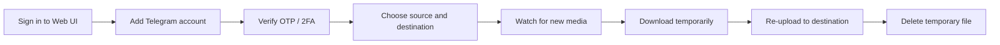

<p align="center">
  
</p>

<h1 align="center">Telegram Restricted Content Forwarder</h1>

<p align="center"><strong>A private, self-hosted console for re-uploading newly received Telegram media.</strong></p>

<p align="center">
  <a href="https://www.python.org/"></a>
  <a href="https://fastapi.tiangolo.com/"></a>
  <a href="https://www.docker.com/"></a>
  <a href="LICENSE"></a>
</p>

<p align="center">
  <a href="#-features">Features</a> ·
  <a href="#-quick-start">Quick Start</a> ·
  <a href="#-configuration">Configuration</a>
</p>

> [!IMPORTANT]
> Use this project only with channels and content you are authorized to access and process. Follow Telegram's Terms of Service and applicable law.

## ✨ Features

- Private, single-owner Web UI protected by HTTP Basic authentication.
- Telegram sign-in with OTP and optional two-step verification.
- Multiple saved Telegram accounts with persistent session storage.
- Source and destination selection by `@username`, invite link, or numeric chat ID.
- Re-uploading of new photos, videos, animations, and video notes.
- A separate **History** page that copies the media already in a channel, oldest first, with albums kept together.
- Caption and caption-entity preservation for supported media.
- Original sender name, and the forward origin when there is one, added to each forwarded item.
- Live worker status, counters, last-forwarded message ID, and activity logs.
- Temporary download cleanup after every forwarding attempt.
- Optional SOCKS5 proxies, automatic reconnection, and graceful Telegram FloodWait handling.
- Docker health check and persistent-volume support for self-hosted deployment.

## 🔄 How it works



When a forwarding job starts, the latest source message becomes the initial checkpoint. The worker then polls for newer messages, so existing history is not copied. Use the [History page](#-copying-existing-history) for what was posted before.

Only one forwarding job can run at a time. The chosen Telegram account must be able to read the source and send media to the destination.

## 🚀 Quick Start

### Prerequisites

- Docker with Docker Compose
- Telegram API credentials from `my.telegram.org`
- A Telegram account with access to both channels

### Run with Docker Compose

```bash
git clone https://github.com/eua-angkoon-n/Telegram-Restricted-Content-Forwarder.git
cd Telegram-Restricted-Content-Forwarder
cp .env.example .env
```

On Windows PowerShell, use `Copy-Item .env.example .env` instead of `cp`.

Edit `.env` and replace the example credentials, then start the service:

```bash
docker compose up --build -d
```

Open [http://localhost:8080](http://localhost:8080) and enter the `APP_USERNAME` and `APP_PASSWORD` values when prompted.

```bash
# View logs
docker compose logs -f

# Stop the service while preserving Telegram sessions
docker compose down
```

> [!CAUTION]
> `docker compose down -v` also deletes the persistent volume and all locally saved Telegram sessions.

## ⚙️ Configuration

| Variable | Required | Default | Description |
| --- | :---: | --- | --- |
| `APP_USERNAME` | Yes | — | Username for the private Web UI. |
| `APP_PASSWORD` | Yes | — | Use a long, random password. |
| `TELEGRAM_API_ID` | Yes | — | Numeric Telegram application ID. |
| `TELEGRAM_API_HASH` | Yes | — | Telegram application hash. |
| `APP_DATA_DIR` | No | `/data` | Persistent sessions, markers, and temporary downloads. |
| `POLL_SECONDS` | No | `5` | Source polling interval; must be greater than zero. |
| `TELEGRAM_PROXIES` | No | Empty | SOCKS5 entries separated by semicolons or new lines. |
| `APP_PORT` | No | `8080` | Host port used by Docker Compose. |

Proxy entries use this format:

```text
host:port:username:password
```

When multiple proxies are configured, each Telegram account always uses the same one, so its session never moves between addresses.

## 📦 Server deployment

Pushes to `main` run the tests and build `telegram-forwarder:sha-<commit>` through GitHub Actions, published as the `telegram-forwarder-image` workflow artifact. The server loads that image with `docker load`; it never builds.

[`deploy/docker-compose.yml`](deploy/docker-compose.yml) is the production stack. It expects a `.env` beside it with the variables above plus `IMAGE_TAG`, listens on `127.0.0.1:3004` for a reverse proxy, and keeps Telegram sessions in `/srv/tg-forwarder/data`.

```bash
docker load -i telegram-forwarder.tar.gz
docker compose up -d
```

Roll back by setting `IMAGE_TAG` to the previous tag, which is still loaded on the server, and running `docker compose up -d`.

### Keeping Telegram sessions alive

- The data directory must be persistent. Telegram sessions are stored there, and a lost directory means signing in again.
- Each account uses one long-lived connection with a fixed device identity, so restarts and upgrades do not look like a new device.
- Network failures are retried with backoff. If Telegram itself ends the session, the console reports **Sign-in required**.
- Telegram can still end a session on its own, for example when it is terminated from another device.

## 🖥️ Using the Web UI

1. Sign in with the Web UI credentials configured in `.env`.
2. Enter a Telegram phone number in international format.
3. Verify the Telegram login code and enter the 2FA password if requested.
4. Choose the saved account, source channel, and destination channel.
5. Select **Start forwarding** and monitor the status, counters, and activity log.
6. Select **Stop** before removing an account or changing the active route.

The 2FA password is used only for the active sign-in request and is never written to disk.

## 📜 Copying existing history

The **History** page (`/history`) re-uploads the media that is already in a source channel. It is a separate job from live forwarding: it has its own status, counters, and log, and both can run at the same time.

1. Open **History**, then choose the saved account, source channel, and destination channel.
2. Select **Start copying**. The job reads from the first message up to the one that is latest at that moment, then finishes as **Complete**. Messages posted later are not part of it.
3. **Stop** keeps the job's place. Starting the same account, source, and destination again carries on from there, so nothing is sent twice. Tick **Start over from the first message** to send everything again. Starting a different route discards the saved place.

How the History job differs from live forwarding:

- Photos and videos that were posted as one album are sent as one album.
- Videos that were posted as files are copied as files. Other files are still skipped.
- A message that fails three times is skipped and listed in the activity log, and the job moves on. A lost connection or a Telegram rate limit never skips a message.

Every item is downloaded and uploaded again, so a large channel takes a long time, and Telegram may impose rate-limit waits along the way.

## 🔐 Security and limitations

- The Web UI entry and all API routes require Basic Auth; `/healthz` and static assets are public.
- Interactive API documentation and the OpenAPI schema are disabled.
- Telegram session files contain sensitive credentials; protect and back up the volume appropriately.
- Temporary media is deleted after each send attempt, including failed attempts.
- The live worker processes only messages received after the current job starts, including those that arrive while the service is restarting. Earlier messages are copied from the History page.
- Unsupported message types are skipped without being forwarded.
- An active forwarding or History job resumes by itself after a restart; a job stopped from the Web UI does not. Counters and activity logs are in memory and reset.
- There is no per-message record of what was sent: starting a History route over, or copying the same source to the same destination twice, sends the items again.
- Run exactly one application replica against a given data volume.

## 🧪 Development and testing

Python 3.11 is recommended.

```bash
python -m venv .venv

# Linux / macOS
source .venv/bin/activate

# Windows PowerShell
.venv\Scripts\Activate.ps1

python -m pip install -r requirements-dev.txt
pytest
```

The test suite covers Web authentication, Telegram account login persistence, account management, forwarding lifecycle, sender attribution, session reuse and reconnection, temporary-file cleanup, retry behavior, FloodWait interruption, and the History job.

## 📄 License

Distributed under the [MIT License](LICENSE).
